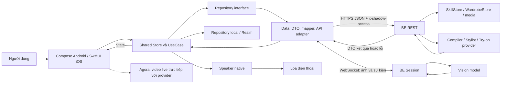
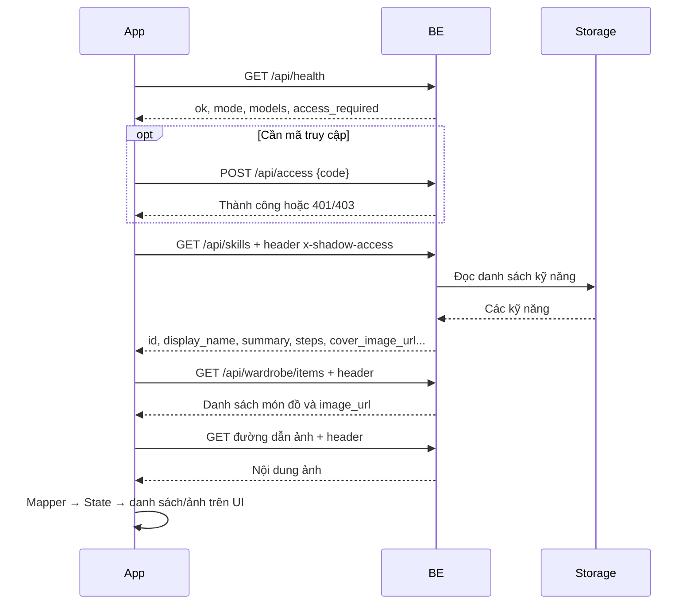
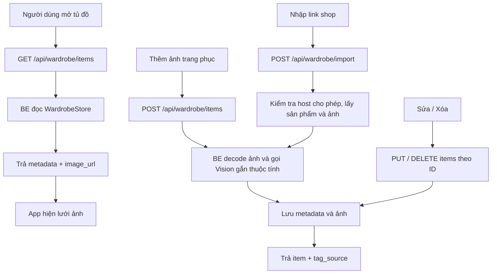
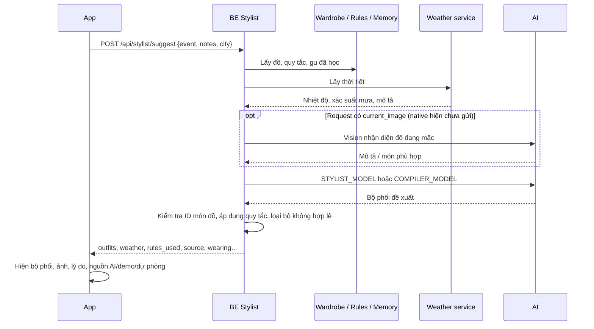
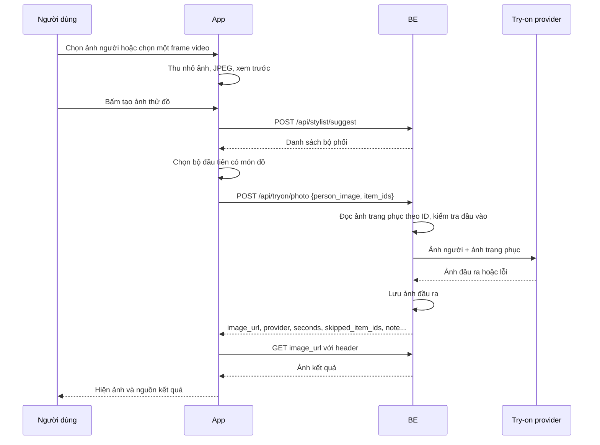
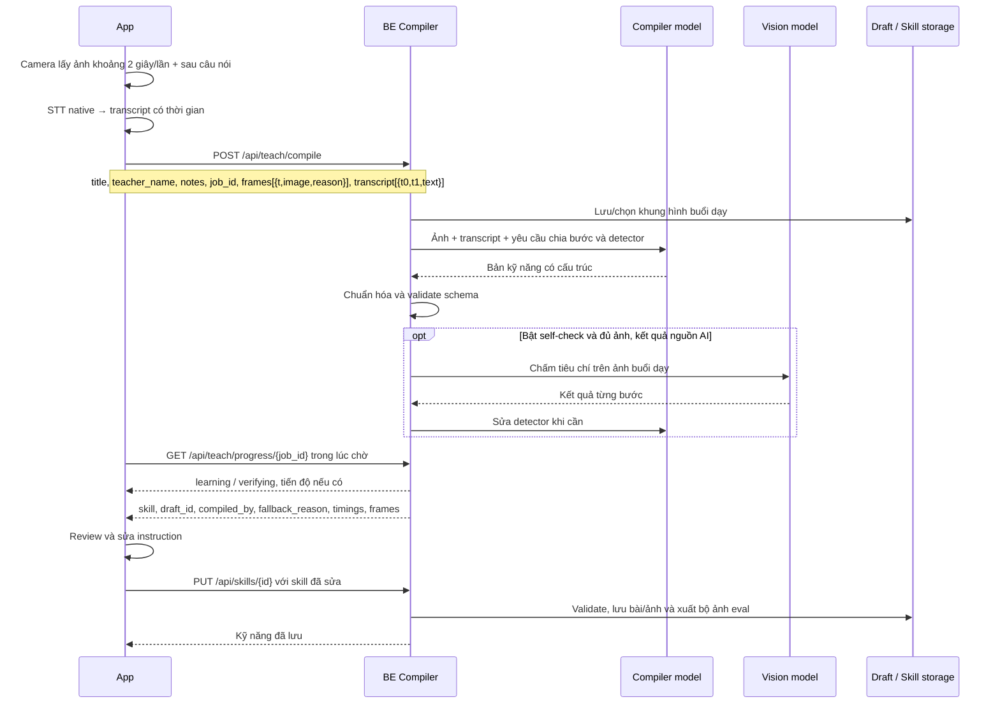
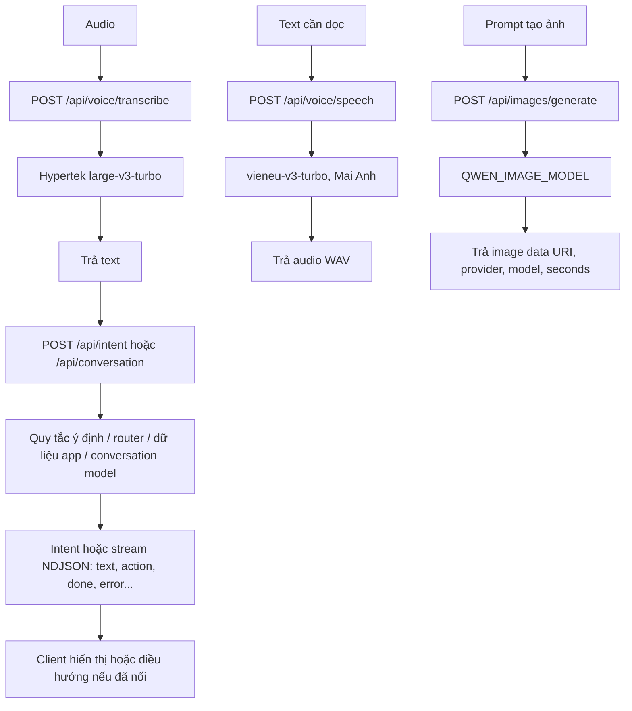
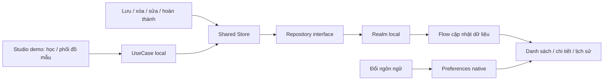

# Toàn bộ luồng chức năng App ↔ BE ↔ AI

Ngày rà: 12/11/2026. App: BaseKMM Android/iOS. BE source: `../shadown-fourward/backend`.

## 1. Kết luận và bằng chứng

BE đáp ứng lõi học từ **khung hình + transcript**, hướng dẫn qua camera, hỏi đáp, tủ đồ, phối đồ và có tích hợp provider thử đồ. BE source **đã có chuỗi upload video gốc → tác vụ SQLite → mở lại kết quả**, cùng UI Android/iOS. Chưa deploy lên server. Xem [hướng dẫn video và nghiệm thu](VIDEO_TEACH.md).

Đọc trực tiếp server `https://fourward.thangqt.com/api/health` trong lượt rà này:

```json
{"ok":true,"mode":"ai","vision_model":"qwen3-vl-8b-instruct","compiler_model":"qwen3.6-35b-a3b","access_required":true}
```

`/api/tryon/config` và `/api/voice/config` trả **401**, cả khi dùng mã hiện được cấu hình trong app. Chưa xác nhận lại provider ảnh/live/voice đang khả dụng. Lần kiểm tra trước live báo false; đó là kết quả cũ, không phải xác nhận mới. Health báo cấu hình, không chứng minh từng lần gọi model sẽ thành công. Không tạo phiên AI tính phí hoặc gửi camera trong lần rà này.

Các nhãn dùng bên dưới:

- **Đã nối:** thấy đường gọi trong source app, chưa đồng nghĩa nghiệm thu máy thật.
- **BE có / app thiếu:** có endpoint trong source BE nhưng native chưa có luồng đầy đủ.
- **Local/demo:** xử lý trên máy, không gọi BE/AI.
- **Đề xuất:** chưa triển khai; không phải API hiện hành.

## 2. Tổng quan



HTTPS dùng cho dữ liệu và ảnh xử lý theo yêu cầu. WebSocket SHADOW dùng cho hướng dẫn theo bước. Video thử áo live đi qua Agora/provider, không phải chuỗi frame gửi vào WebSocket hướng dẫn.

## 3. Model/mode nào được gọi

`mode` là chế độ (`ai`/`mock`); `model` là model cụ thể. `provider` là dịch vụ cung cấp. Ba khái niệm này khác nhau.

| Tác vụ | BE gọi gì theo source | Cấu hình live đã xác nhận? |
|---|---|---|
| Học/biên dịch kỹ năng | `COMPILER_MODEL` qua `LLMProvider.chat_json` | `qwen3.6-35b-a3b` từ health |
| Tự kiểm chứng kỹ năng | `VISION_MODEL` chấm ảnh; compiler hỗ trợ sửa detector | Vision: `qwen3-vl-8b-instruct` |
| Camera kiểm tra thao tác, gợi ý, hỏi về kỹ năng | `VISION_MODEL` trong vision runtime | `qwen3-vl-8b-instruct` |
| Nhận diện thuộc tính trang phục/đồ đang mặc | `VISION_MODEL` | Cùng cấu hình vision; chưa gọi chức năng thật lượt này |
| Gợi ý phối đồ | `STYLIST_MODEL`, thiếu thì dùng `COMPILER_MODEL` | Chưa biết override stylist của server |
| Trò chuyện tổng quát | `CONVERSATION_MODEL`, thiếu thì dùng compiler | Chưa biết override conversation |
| Thử đồ ảnh | Provider chain: Vidu / worker / HF Space / mock tùy cấu hình | Config đang bị 401; nhánh Vidu trong source dùng `viduq2` |
| Thử áo live native | Vidu `vidu-s2-editing`; Agora truyền video | Source có; config hiện chưa đọc được |
| Tạo ảnh theo prompt | `QWEN_IMAGE_MODEL`, mặc định `Qwen/Qwen-Image-2.1` | Chưa xác nhận runtime |
| Voice BE tùy chọn | Hypertek STT `large-v3-turbo`; TTS `vieneu-v3-turbo`, giọng `Mai Anh` | Config đang bị 401; app native chưa nối luồng này |
| TTS/STT app hiện tại | iOS AVSpeechSynthesizer/SFSpeechRecognizer; Android TextToSpeech/SpeechRecognizer | SDK hệ điều hành, không gọi model BE |
| Phân loại ý định | Quy tắc local trước; tùy cấu hình Jev `typesafe/jev-1.14` hoặc Laya | Native chưa nối; chưa xác nhận provider runtime |

Key AI nằm ở BE. App chỉ giữ mã truy cập server và nhận thông tin phiên live cần thiết. Auto fallback chỉ tồn tại ở một số nhánh BE, không phải cơ chế chung toàn hệ thống; có thể rơi về mock/rule-based. UI cần hiển thị nguồn kết quả.

## 4. Mở app, kết nối và tải dữ liệu — đã nối



Mất mạng hoặc mã sai: báo lỗi và reconnect. Mã được giữ trong phiên, không nằm trong state hiển thị. Hiện mã app bị server từ chối: chặn các bài test API được bảo vệ. Ảnh tham chiếu ở Guide còn thiếu header, cần sửa dù ảnh tủ đồ đã có loader hỗ trợ header.

## 5. Tủ đồ: xem, thêm, sửa, xóa, nhập từ link



- Native đã đọc tủ đồ. Thêm/quản lý đồ server hiện có đường mở web, chưa là CRUD native đầy đủ.
- BE có đủ endpoint CRUD, nhập link có giới hạn host, seed dữ liệu demo.
- Đầu vào tạo món: ảnh data URI, tên/category tùy chọn. Đầu ra: ID, tên, loại, màu/thuộc tính, ảnh, nguồn gắn nhãn.
- Không nhầm tủ đồ mẫu trong Realm với tủ đồ trên server.

## 6. Phối đồ theo dịp/thời tiết — đã nối một phần



Native hiện gửi thành phố mặc định Hà Nội. BE còn hỗ trợ tọa độ/ngày, món giữ cố định, ảnh đồ đang mặc và thông tin phản hồi. App chưa tận dụng đầy đủ các trường này. Tủ trống trả 409.

### Gu cá nhân, quy tắc và bộ mẫu — BE có / app thiếu luồng đầy đủ

- `GET/POST/PUT/DELETE /api/wardrobe/rules...`: lưu/sửa/xóa quy tắc phối đồ.
- `POST /api/stylist/feedback`: nhận `item_ids`, `vote=up|down|wear`, dịp, thời tiết, lý do; ghi bộ nhớ sở thích → trả `ok`, nội dung đã ghi nhận, `profile`.
- `GET/DELETE /api/stylist/profile`: xem/reset gu đã học.
- `GET/POST/DELETE /api/wardrobe/examples...`: lưu/xem/xóa bộ mẫu người dùng dạy.
- Kết quả được dùng trong lần suggest sau. Đây chủ yếu là lưu dữ liệu và logic chấm/phối, không phải mỗi thao tác đều huấn luyện lại model AI.

## 7. Thử đồ bằng ảnh / chọn khung hình video — đã nối



- Video nhập ở luồng này chỉ để chọn một ảnh; không xuất video mặc đồ.
- Nhánh auto thử đồ ảnh có thể dùng worker → HF Space → mock theo trạng thái; khi chọn Vidu có cấu hình thì nhánh Vidu không tự đảm bảo chuyển sang mọi provider khác.
- Nhãn `mock` là ảnh demo, không được nghiệm thu là AI mặc đồ thành công.
- Hủy HTTP giúp BE ngừng chờ và không lưu kết quả; không chứng minh nhà cung cấp đã hoàn tiền/dừng tính phí.
- Bug cần sửa: Android còn giữ ảnh người cũ khi đọc ảnh mới thất bại.

## 8. Thử áo live native — đã nối source, chưa nghiệm thu dịch vụ

```mermaid
sequenceDiagram
    participant A as App native
    participant B as BE
    participant V as Vidu
    participant R as Agora
    A->>B: GET /api/tryon/config
    B-->>A: live.available, provider, model, giới hạn phiên
    A->>B: Tải ảnh áo được chọn trong tủ
    A->>B: POST /api/tryon/live-session {reference_image}
    B->>V: Tạo phiên bằng khóa server
    V-->>B: Thông tin phiên, RTC, socket
    B-->>A: live_id, ws_url, client_secret, rtc, render_uid, max_session_seconds
    A->>V: Control WebSocket: init
    V-->>A: Init ACK / lỗi
    A->>R: Join RTC, publish camera, không publish microphone
    R->>V: Camera để xử lý
    V->>R: Video AI đầu ra
    R-->>A: Remote video
    A->>V: Control type 13 khi đổi áo
    V-->>A: Type 14 khi đổi thất bại; không có success ACK
    A->>A: Thoát/background → stop engine, socket, timer
```

Native hiện tập trung một áo (`top`). Chưa chứng minh quần/giày/mũ, chất lượng 360°, FPS/độ trễ/RAM. “Đã gửi áo mới” không có nghĩa video đã mặc đúng áo. BE còn endpoint Decart cũ `/live-token`, `/live-prompt`; native hiện dùng Vidu `/live-session`.

## 9. Dạy kỹ năng: camera + transcript — đã nối review và xác minh



Giới hạn request hiện tại: 64 frame, 600 dòng transcript. Endpoint compile này nhận ảnh/transcript; video gốc dùng API riêng ở mục 10. Kỹ năng gồm summary, tasks, steps, ảnh tham chiếu, detector, lời đọc; có thể có quality/verify. Lỗi AI có thể trả bản mock/rule-based, thông qua `compiled_by` và `fallback_reason`. Self-check lỗi có thể trả bài chưa được kiểm chứng.

Native hiển thị summary, nguồn AI/mock, cảnh báo, ảnh và kết quả kiểm chứng từng bước. Đổi instruction đồng bộ lời đọc, đánh dấu cần kiểm chứng và chặn lưu. `verify-step` gửi `refresh_detector=true`; BE tạo tiêu chí mới trước khi chấm, app chỉ chấp nhận khi BE xác nhận `detector_refreshed` và kết quả `ok`/`fixed`. BE cũ sẽ không cho lưu bản sửa qua luồng này.

Compile camera vẫn là request trực tiếp. TeachStore đã chặn compile/save trùng, bỏ callback cũ sau Reset/close và giới hạn thời gian chờ capture. Tác vụ có thể mở lại sau khi đóng app thuộc luồng video bên dưới.

## 10. Học từ nguyên video — đã triển khai source Android/iOS/BE

```mermaid
sequenceDiagram
    participant A as App Android/iOS
    participant B as API video
    participant Q as Worker + SQLite
    participant C as Compiler/Verifier
    A->>B: GET /api/teach/video/config
    A->>B: POST /api/teach/video/uploads (stream tối đa 32 MB)
    B-->>A: job_id + token riêng
    A->>A: Lưu ticket và đường dẫn video gốc trên máy
    A->>B: POST /jobs/{id}/start (title, teacher_name, notes)
    B->>Q: queued; một worker xử lý
    Q->>Q: ffprobe/ffmpeg; tối đa 24 ảnh; audio từng đoạn 15 giây
    opt Có audio và cấu hình STT
        Q->>Q: large-v3-turbo → transcript theo đoạn
    end
    Q->>C: Ảnh + transcript + ghi chú
    C-->>Q: skill draft, ảnh, nguồn, kiểm chứng
    Q->>Q: Lưu kết quả trước khi đánh dấu ready
    A->>B: GET /jobs/{id} + token (poll hoặc mở lại)
    B-->>A: trạng thái / lỗi / bản nháp
    A->>A: Review, xem video gốc, sửa và verify lại
    A->>B: PUT /api/skills/{id}
    B-->>A: Bài đã lưu để mở Guide
```

API còn có `/retry`, `/cancel`, `DELETE /jobs/{id}`, `GET /jobs/{id}/source`. Đóng màn hình dừng upload/poll phía app, không hủy job đã chạy trên BE. Server restart đánh dấu tác vụ đang xử lý là `interrupted`; người dùng chủ động thử lại để tránh tự lặp cuộc gọi AI. Không hỗ trợ tiếp tục upload từ byte bị ngắt. Xem [giới hạn và cấu hình](VIDEO_TEACH.md).

## 11. Hướng dẫn gấp áo / gấp quần / gói quà / bài đã học

```mermaid
sequenceDiagram
    participant A as App
    participant B as BE Session
    participant S as Skill storage
    participant V as Vision model
    participant T as TTS điện thoại
    opt Bài có sẵn của app chưa có trên server
        A->>S: Qua PUT /api/skills/{id}: đăng ký bài và detector
    end
    A->>B: WS /session/control + mã truy cập
    A->>B: session.start {skill_id}
    B->>S: Tải bài và tạo trạng thái phiên
    B-->>A: session.ready, hud.state, speech
    A->>T: Đọc text tiếng Việt
    loop Trong lúc người dùng làm
        A->>B: vision.frame {image, ts, trigger}
        B->>V: Ảnh hiện tại + detector bước + ảnh tham chiếu theo cấu hình
        V-->>B: Kết quả nhận diện / hint
        B->>B: Kiểm tra frame cũ, điều kiện xác nhận và trạng thái bước
        B-->>A: vision.result
        opt Cần ảnh xác nhận tiếp theo
            A->>B: Frame mới ngay khi confirming
        end
        opt Bước hoàn thành
            B-->>A: hud.state bước mới + speech có epoch mới
            A->>T: Ngắt câu cũ, đọc câu mới
        end
    end
    B-->>A: hud.state phase COMPLETED
    A->>A: Hiện hoàn thành; lưu lịch sử khi callback được nối
```

Frame định kỳ khoảng 1,5 giây, cạnh ảnh tối đa theo session.ready (mặc định 448). Vision xét từng ảnh; không đồng nghĩa hiểu đầy đủ chuyển động video. App dùng epoch để bỏ lời nói cũ. “Nghe lại” chỉ gọi TTS local. Chuyển bước thủ công gửi `debug.step`, phải phân biệt với AI tự xác nhận.

Các bài builtin có 4 bước. Test server trước đây chỉ xác nhận bài gói quà được đăng ký, nhận bước đầu và speech; chưa gửi ảnh chứng minh AI chấm toàn bộ thao tác. Callback hoàn thành từ Home đã nối lịch sử. Guide thoát khi vào background; Teach dừng camera/mic. Có cảnh báo khi TTS tiếng Việt không khả dụng; vẫn cần nghiệm thu trên máy thật.

## 12. Xem bài và hỏi đáp

```mermaid
sequenceDiagram
    participant A as App
    participant B as BE
    participant V as Vision runtime / model
    A->>B: GET /api/skills/{id}
    B-->>A: Tên, summary, steps, ảnh, lời hướng dẫn
    A->>A: Hiển thị bài; chế độ thủ công tự chuyển bước
    A->>B: POST /api/ask {skill_id, step_id, question}
    B->>B: Nạp ngữ cảnh kỹ năng và bước
    B->>V: Câu hỏi + ngữ cảnh (BE hỗ trợ ảnh tùy chọn)
    V-->>B: Câu trả lời hoặc lỗi
    B-->>A: answer, source = ai / mock / fallback
    A->>A: Hiện câu trả lời và nguồn
```

Native hiện không gửi ảnh trong `ask`. Khi AI lỗi, BE có thể trả câu từ nội dung bài với source fallback. Đọc bài thủ công không đồng nghĩa đang có AI theo dõi camera.

## 13. Voice, trò chuyện và tạo ảnh bổ sung — BE có / native chưa nối đầy đủ



STT BE giới hạn audio 4 MB, output text bị giới hạn 500 ký tự trong endpoint hiện tại: chưa phù hợp dùng nguyên endpoint đó cho transcript video dài có timestamps. TTS BE tùy chọn; hướng dẫn native hiện không gọi nó. Conversation có stream và gợi ý action, không có nghĩa BE tự mở màn hình app. Native cần route mapping và xử lý stream nếu muốn đưa chức năng này vào sản phẩm.

## 14. Lịch sử, Notes, cài đặt và các màn mẫu — LOCAL



- Notes: danh sách, tạo/sửa/xóa, validation, lưu Realm; không gọi AI.
- Looks/lịch sử: dữ liệu local và bản ghi hoàn thành được nối qua callback; chưa có đồng bộ lịch sử với BE giữa hai máy.
- Studio: thêm đồ mẫu, học bài mẫu, phối đồ mẫu, sửa/lưu/xóa; dùng `BuildDemoSkillUseCase`/`SuggestDemoOutfitsUseCase`, không phải kết quả AI server.
- Ngôn ngữ ở preferences native; dark/glass và dữ liệu Studio theo store local. Reconnect thuộc luồng kết nối server ở mục 4.
- Camera preview, focus, torch, flip, chọn ảnh/video và phát giọng là khả năng thiết bị. Chỉ gửi media khi luồng nghiệp vụ tương ứng yêu cầu.

## 15. Thu thập mẫu kiểm chứng AI — BE có, dành cho đánh giá

`POST /api/eval/capture`: gửi skill_id, step_id, nhãn done/not_done và ảnh → lưu bộ ảnh đánh giá. `GET /api/eval/{skill_id}` đọc thông tin bộ mẫu; `DELETE .../last` bỏ ảnh cuối theo nhãn. Lưu skill đã dạy còn tự xuất bộ ảnh eval từ ảnh buổi dạy. Các API này không tự chứng minh độ chính xác; cần chạy đánh giá với dữ liệu độc lập và người thực hiện khác. Native chưa có luồng đánh nhãn/đánh giá đầy đủ.

## 16. Quy tắc lỗi và những phần cần sửa

| Tình huống | Hiện trạng / yêu cầu |
|---|---|
| Sai mã 401/403 | Chặn request, nhập lại mã; hiện đang chặn kiểm tra server |
| Thiếu dữ liệu 404 / đầu vào 422 / ảnh quá lớn 413 | Hiển thị lỗi có thể sửa; không báo thành công |
| Tủ trống 409 | Thêm món hoặc dùng dữ liệu demo có nhãn |
| Quota/rate 429 / upstream 5xx | Báo rõ, tránh retry vô hạn hoặc tạo phiên tính phí lặp |
| Compile trả mock hoặc self-check thiếu | Đã hiện source/fallback và kiểm chứng từng bước; cần đánh giá chất lượng AI thật |
| Thoát/hủy/Reset | Teach đã có generation/cancellation và chống compile/save trùng |
| Lỗi đọc ảnh mới | Android/iOS đã xóa ảnh cũ trước khi đọc ảnh thay thế |
| Mất mạng guide | Có reconnect; cần nghiệm thu bước thực tế sau nối lại, không mặc định đã resume hoàn hảo |
| Speech tiếng Việt không sẵn sàng | Đã hiện cảnh báo; chưa tự chuyển sang TTS BE |
| Save bài đã sửa | Đồng bộ lời đọc, đánh dấu bản sửa, yêu cầu tạo lại detector và verify trước lưu |

## 17. Phạm vi test toàn bộ chức năng trên Android và iOS

Mỗi dòng cần thực hiện riêng trên **Android thật** và **iPhone thật**. Ghi build, model máy, OS, thời gian, mạng, kết quả quan sát và log liên quan. Không đánh Pass từ việc endpoint tồn tại.

| ID | Bài test và đầu ra cần thấy | Phân loại hiện tại |
|---|---|---|
| T01 | Mở app, chuyển 4 tab, back, mở lại; không mất điều hướng | Chưa nghiệm thu máy thật |
| T02 | Kết nối mã đúng/sai, offline/reconnect; danh sách tải đúng hoặc lỗi rõ | Bị chặn bởi mã truy cập |
| T03 | Danh sách/chi tiết bài, ảnh tham chiếu, bài không tồn tại | API đã nối; ảnh Guide có header cùng origin |
| T04 | Hỏi về bước; câu trả lời có source; thử lỗi mạng | API đã nối |
| T05 | Xem tủ, tủ trống, ảnh lỗi; thêm/sửa/xóa qua đường hiện có | Native CRUD còn thiếu, đường quản lý mở web |
| T06 | Phối đồ theo dịp; kết quả có món, ảnh, lý do, weather/source | API đã nối |
| T07 | Chọn/đổi/hủy ảnh; chọn frame video; lỗi media không giữ nhầm ảnh | Đã sửa giữ nhầm ảnh cũ; cần test picker trên thiết bị |
| T08 | Tạo ảnh thử đồ, hủy, bấm lặp; thấy ảnh kết quả đúng người/đồ và nguồn | Cần mã và provider hoạt động |
| T09 | Live: xin/từ chối camera, mở phiên, thấy remote video, đổi áo, hết giờ, thoát | Chưa xác nhận config hiện tại; cần nghiệm thu dịch vụ |
| T10 | Dạy bằng camera + lời nói/ghi chú → compile → review → lưu → mở lại bài | Đã sửa duplicate/reset; host tests pass |
| T11 | Quay/chọn video gốc → job học → mở lại bản nháp | Đã triển khai; cần deploy BE và test AI thật |
| T12 | Review ảnh theo bước, quality/source, chọn ảnh mới và verify lại | Đã nối review/đổi ảnh/verify; cần BE mới |
| T13 | Gấp áo đủ 4 bước, nghe lại, manual, AI, hoàn thành | Chưa nghiệm thu camera thật |
| T14 | Gấp quần đủ 4 bước, người khác làm theo | Chưa nghiệm thu camera thật |
| T15 | Gói quà đủ 4 bước; AI không chuyển khi thao tác chưa xong | Mới kiểm chứng server trả bước đầu/speech trước đây |
| T16 | Bài tự dạy: người khác làm lại; sai/che khuất/thiếu sáng | Chưa nghiệm thu |
| T17 | Lịch sử từ mọi đường vào, mở chi tiết, khởi động lại | Đã nối callback Home; cần test UI và persistence |
| T18 | Notes tạo/sửa/xóa, input trống, lưu rồi mở lại | Local, cần kiểm thử UI |
| T19 | Studio/Looks mẫu: thêm đồ, phối, học/sửa bài, lưu/xóa; nhãn demo rõ | Local/demo |
| T20 | Việt/English, giao diện, reconnect, xóa dữ liệu demo | Local + kết nối |
| T21 | Camera/micro bị từ chối, background, khóa máy, mất mạng, mở/thoát lặp | Đã thêm xử lý background/callback cũ; cần test vòng đời trên máy thật |
| T22 | Voice BE, conversation, image generation, feedback/profile/rules/examples | BE có, native chưa đủ UI/flow; test API riêng sau xác thực |

Bằng chứng ngày 12/11/2026: Android APK và iOS Simulator build thành công; XML shared host tests báo **81 tests, 0 failures/errors**. Trong đó **4 LiveServerTest return sớm khi chưa opt-in**, không tính là kiểm tra server thật. BE staged suite **290 passed** (có ffmpeg thật, AI mock trong test video); đã áp dụng và đối chiếu SHA256 vào repo BE. Chưa build Docker image, chưa deploy. iPhone thật còn cần signing hợp lệ.

## 18. Việc còn cần nghiệm thu

1. Cập nhật mã truy cập hợp lệ; deploy BE mới và bật video theo VIDEO_TEACH.md.
2. Học một clip ngắn, kiểm tra draft/nguồn/ảnh, sửa và verify, lưu rồi để người khác làm lại.
3. Test đủ ma trận trên Android/iPhone thật, bao gồm mạng lỗi, hủy, background, mic/camera bị từ chối.
4. Đo lỗi AI nhận nhầm hoàn thành trên ảnh sai/che khuất/ánh sáng yếu; chưa thể suy ra từ unit tests.
5. Các native flow quản lý tủ, profile/rules/conversation còn chưa đầy đủ như đã ghi riêng ở trên.

## 19. Nguồn đối chiếu

- BE: `main.py`, `skill_compiler.py`, `skill_verify.py`, `vision_runtime.py`, `providers.py`, `wardrobe_api.py`, `stylist.py`, `tryon.py`, `vidu_live.py`, `vidu_image.py`, `voice_api.py`, `intent_router.py`, `conversation.py`, `qwen_image.py`.
- App: `shared/presentation`, `shared/data/remote`, `shared/data/mapper`, `shared/domain/repository`, native `Platform`, `Features`/`features` và Navigation.
- [Kiến trúc folder và thay provider](ARCHITECTURE.md), [tiêu chí live](LIVE_TRYON_ACCEPTANCE.md).

## 20. Danh mục endpoint đăng ký trong source BE

Bao gồm cả API bổ sung chưa có UI native; không phải xác nhận deployment đã bật tất cả.

| Method | Endpoint | Source |
|---|---|---|
| `GET` | `/api/health` | `main.py:119` |
| `POST` | `/api/access` | `main.py:134` |
| `GET` | `/api/skills` | `main.py:147` |
| `GET` | `/api/skills/{skill_id}` | `main.py:152` |
| `PUT` | `/api/skills/{skill_id}` | `main.py:162` |
| `DELETE` | `/api/skills/{skill_id}` | `main.py:189` |
| `GET` | `/skills-media/{skill_id}/{rel_path:path}` | `main.py:196` |
| `POST` | `/api/teach/compile` | `main.py:209` |
| `GET` | `/api/teach/progress/{job_id}` | `main.py:285` |
| `GET` | `/api/teach/frames` | `main.py:308` |
| `POST` | `/api/teach/verify-step` | `main.py:336` |
| `POST` | `/api/ask` | `main.py:422` |
| `POST` | `/api/eval/capture` | `main.py:454` |
| `GET` | `/api/eval/{skill_id}` | `main.py:465` |
| `DELETE` | `/api/eval/{skill_id}/{step_id}/{label}/last` | `main.py:473` |
| `WEBSOCKET` | `/session/control` | `main.py:487` |
| `GET` | `/api/wardrobe/items` | `wardrobe_api.py:102` |
| `GET` | `/api/wardrobe/items/{item_id}` | `wardrobe_api.py:107` |
| `POST` | `/api/wardrobe/items` | `wardrobe_api.py:115` |
| `POST` | `/api/wardrobe/import` | `wardrobe_api.py:134` |
| `PUT` | `/api/wardrobe/items/{item_id}` | `wardrobe_api.py:145` |
| `DELETE` | `/api/wardrobe/items/{item_id}` | `wardrobe_api.py:155` |
| `POST` | `/api/wardrobe/seed-demo` | `wardrobe_api.py:176` |
| `GET` | `/api/wardrobe/rules` | `wardrobe_api.py:239` |
| `POST` | `/api/wardrobe/rules` | `wardrobe_api.py:247` |
| `DELETE` | `/api/wardrobe/rules/{rule_id}` | `wardrobe_api.py:260` |
| `GET` | `/api/weather` | `wardrobe_api.py:270` |
| `POST` | `/api/stylist/suggest` | `wardrobe_api.py:295` |
| `GET` | `/api/tryon/config` | `wardrobe_api.py:370` |
| `POST` | `/api/tryon/live-token` | `wardrobe_api.py:377` |
| `POST` | `/api/tryon/live-prompt` | `wardrobe_api.py:399` |
| `POST` | `/api/tryon/photo` | `wardrobe_api.py:414` |
| `GET` | `/wardrobe-media/{rel_path:path}` | `wardrobe_api.py:448` |
| `PUT` | `/api/wardrobe/rules/{rule_id}` | `wardrobe_api.py:468` |
| `POST` | `/api/stylist/feedback` | `wardrobe_api.py:527` |
| `GET` | `/api/stylist/profile` | `wardrobe_api.py:560` |
| `DELETE` | `/api/stylist/profile` | `wardrobe_api.py:565` |
| `GET` | `/api/wardrobe/examples` | `wardrobe_api.py:591` |
| `POST` | `/api/wardrobe/examples` | `wardrobe_api.py:598` |
| `DELETE` | `/api/wardrobe/examples/{example_id}` | `wardrobe_api.py:612` |
| `POST` | `/api/tryon/live-session` | `vidu_live.py:168` |
| `GET` | `/api/voice/config` | `voice_api.py:39` |
| `POST` | `/api/voice/transcribe` | `voice_api.py:61` |
| `POST` | `/api/voice/speech` | `voice_api.py:88` |
| `POST` | `/api/intent` | `intent_router.py:140` |
| `POST` | `/api/conversation` | `conversation.py:215` |
| `GET` | `/api/images/config` | `qwen_image.py:118` |
| `POST` | `/api/images/generate` | `qwen_image.py:124` |

### Endpoint video bổ sung trong source (chưa deploy)

| Method | Endpoint | Kết quả |
|---|---|---|
| GET | `/api/teach/video/config` | available, max_bytes, max_seconds, transcription_available |
| POST | `/api/teach/video/uploads` | job_id, token, status |
| POST | `/api/teach/video/jobs/{id}/start` | queued; gọi lại không tạo job thứ hai |
| GET | `/api/teach/video/jobs/{id}` | status, error, progress, result khi ready |
| POST | `/api/teach/video/jobs/{id}/retry` | chạy lại khi failed/interrupted/cancelled |
| POST | `/api/teach/video/jobs/{id}/cancel` | dừng worker, giữ video |
| DELETE | `/api/teach/video/jobs/{id}` | xóa video/job output, gọi lặp được |
| GET | `/api/teach/video/jobs/{id}/source` | tải video gốc với token và access gate |
